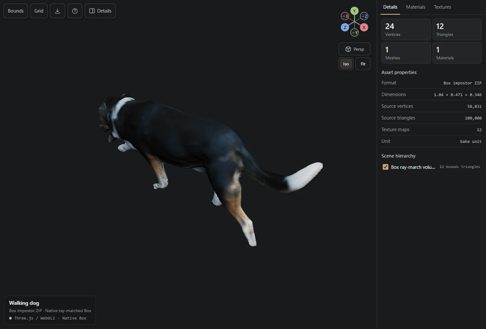

# Chat 3D Inspector

モデルファイルを1つ指定すると、ブラウザやChatGPTのサイドバーで開けるHTMLを生成します。既定のHTMLにはモデル、テクスチャ、描画ライブラリが入っています。

```bash
python skills/chat-3d-viewer/view.py model.glb
```

標準出力にHTMLの絶対パスが出ます。エージェントはそのファイルをリンクで渡せます。初回に足りないPythonパッケージは専用のキャッシュにインストールします。配布用ZIPにはビルド済みのランタイムが含まれています。[Skill ZIP](chat-3d-viewer-skill.zip) · [エージェント用の手順](skills/chat-3d-viewer/SKILL.md)



## ビューアの操作

右上のギズモをドラッグするとモデルの周囲を回転します。X・Y・Zの正負の軸をクリックすると、その方向に視点が揃います。軸の手前側をもう一度押すと反対側に回ります。`Persp / Ortho` または `P` で投影を切り替えられます。`Fit` または `F` は今の向きを保ってモデル全体を画面に収めます。

`Details` では頂点・三角形の数、各メッシュの表示、マテリアル、テクスチャのRGBAチャンネルとUVを確認できます。アニメーションがあるモデルには再生、一時停止、クリップ選択、シークが表示されます。

## 入力と描画

| 入力 | 表示内容 |
| --- | --- |
| GLB・glTF | 静的メッシュは軽量版を使用。骨格、モーフ、アニメーション、対応する拡張マテリアルを含むモデルにはglTFローダーを組み込む |
| OBJ・STL・OFF・3MF・DAE | 三角形メッシュと、読み取れた色・マテリアル・テクスチャ |
| FBX・BLEND | BlenderでGLBに変換。BLENDはアクティブシーンの可視オブジェクトを対象に、対応する材質とアニメーションを引き継ぐ |
| STEP・IGES・BREP | Open CASCADEで曲面を三角形に変換。3D形状の確認に対応し、寸法注記と部品色は省略 |
| USD・USDA・USDC・USDZ | OpenUSDでステージ開始時刻を評価した静的表示。座標系とスケールを反映 |
| PLY・XYZ | PLYの面または点群を表示。XYZは位置と任意のRGB・RGBAに対応 |
| Gaussian PLY・SPLAT | 位置、スケール、回転、不透明度を使ったガウシアンスプラット表示 |
| `.box.zip` | 元のRGBA16Fマップとthree-impostorを使ったレイマーチング。境界形状の12三角形と元モデルの統計を区別して表示 |

Draco・meshoptで圧縮されたジオメトリは生成時に展開します。KTX2（Basis）のテクスチャはPNGに変換します。meshoptとBasisのデコードが必要な場合は、生成する環境にNode.jsを用意してください。

各HTMLには入力に合うランタイムを1種類だけ入れます。たとえばSTLの表示にBox用シェーダーやglTFローダーは入りません。`--runtime-source cdn` を指定すると、描画ライブラリだけを固定バージョンのESモジュールとして読み込みます。glTFの `.bin` やOBJの `.mtl`、テクスチャは変換前にモデルから参照できる位置に置いてください。

ビューアは最初にWebGPUでの描画を試し、必要に応じてWebGL2、Canvas 2Dの順に切り替えます。左下で現在の描画方式を確認できます。Canvas 2DではBoxがサンプル面、点群とスプラットが点の簡易表示になり、アニメーションは静止します。[形式ごとの詳細とオプション](skills/chat-3d-viewer/README.md)

## 開発とテスト

```bash
npm ci
npm run bundle
python -m pip install -r skills/chat-3d-viewer/requirements.txt
python -m unittest discover -s skills/chat-3d-viewer/tests -p 'test_*.py'
node tests/camera.mjs
python tests/make_previews.py
npx playwright install chromium
npm run test:browser
python tools/package_skill.py
```

## ライセンス

本体と同梱のThree.js・three-impostorはMITライセンスです。UIの配色と余白の設計にはDamir Sokolovskyのunslopを参考にしました。[第三者ライセンス](skills/chat-3d-viewer/assets/THIRD_PARTY_LICENSES.txt) · [unslop（CC BY 4.0）](https://github.com/heydamir/unslop)
