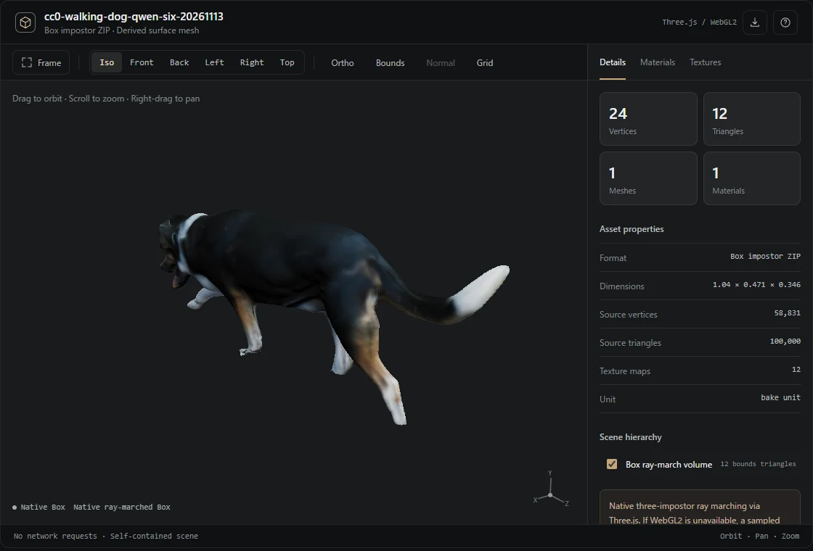

# Chat 3D Inspector

ChatGPTやコーディングエージェントで利用できる、**独立した3Dモデル検査Skill**です。GLBなどのメッシュと、ComfyUI Box Impostor Factoryの`.box.zip`を扱えます。



## 描画方式

Box ImpostorはThree.js 0.186.0と`three-impostor` 0.4.1の`ImpostorNodeMaterial`を使い、16bit浮動小数点の各マップから**本来のレイマーチングで描画**します。以前の深度ガイドから作る三角形モデルは、WebGL2を使えない場合の代替表示だけに残しました。Boxの24頂点・12三角形は境界形状の数であり、表面の複雑さを示す数ではありません。

GLB・glTF・OBJ・PLY・STL・3MFはtrimeshを経由してメッシュとマテリアルを読み込み、Three.jsの`MeshStandardMaterial`で描画します。表示にはモデル統計、マテリアル一覧、テクスチャのRGBAチャンネル表示、UV重ね表示、視点操作を備えています。3DGS、リギング、アニメーション、複雑なglTF拡張の完全な再現には未対応です。

## 使い方

[Skill本体](skills/chat-3d-viewer/SKILL.md)の手順に従ってインストールしてください。配布用の[Skill ZIP](chat-3d-viewer-skill.zip)も提供しています。

```bash
python -m pip install -r skills/chat-3d-viewer/requirements.txt
python skills/chat-3d-viewer/scripts/build_viewer.py model.glb -o model.inspector.html
python skills/chat-3d-viewer/scripts/build_viewer.py model.box.zip -o box.inspector.html
python skills/chat-3d-viewer/scripts/build_viewer.py model.box.zip --runtime-source cdn -o box.cdn.inspector.html
```

通常の出力HTMLは**固定バージョンのThree.js・three-impostorとアセットの全データを内包**し、CDN通信なしで表示できます。一方、サイドバーの実測でCDNの`fetch()`だけが失敗しES Moduleの`import`は成功したため、`--runtime-source cdn`も追加しました。このモードは**モデルデータをHTMLに内包したまま**、ライブラリのみCDNからインポートします。ComfyUIサーバーやGPU推論はいずれのモードでも必要ありません。インラインHTML実行に対応しないChatGPT環境では、ダウンロードできるHTMLとスクリーンショットを渡します。WebGL2が禁止されている場合は、Canvas2Dの簡易表示へ切り替えます。

### 開発・テスト

```bash
npm ci
npm run bundle
python -m unittest discover -s skills/chat-3d-viewer/tests -p 'test_*.py'
npm run test:browser
npm run probe:cdn
python tools/package_skill.py
```

`npm run bundle`はバージョンを固定した依存ライブラリをまとめ直す開発用コマンドで、通常の閲覧・HTML生成時には不要です。ブラウザテストはPlaywrightとWebGL2が使える環境を必要とします。Windows Edge＋SwiftShaderの検証については[実機記録](docs/verification/native-box-20261113.md)をご覧ください。

## 権利表記

このSkillのコードはMITライセンスです。[Three.js](https://threejs.org/)と[three-impostor](https://www.npmjs.com/package/three-impostor)もMITライセンスで、全文は[同梱の第三者ライセンス](skills/chat-3d-viewer/assets/THIRD_PARTY_LICENSES.txt)に収録しています。UIデザインの見直しはDamir Sokolovskyによる[unslop](https://github.com/heydamir/unslop)（CC BY 4.0）の方針を参考にしました。
