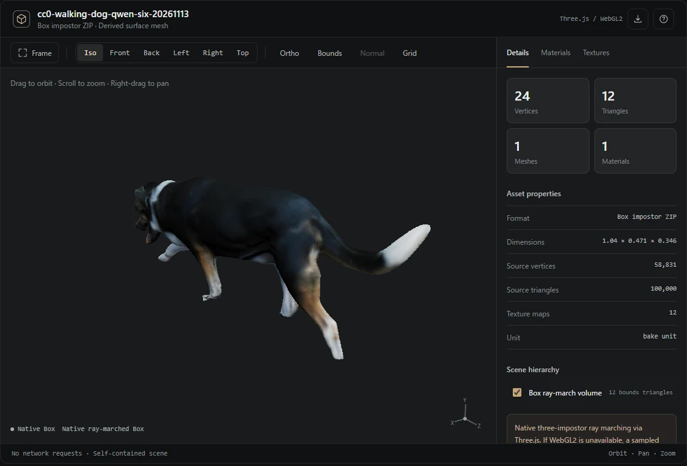

# Native Three.js／Box Impostor 検証（270-PC）

検証日：2026年11月13日  
対象：独立リポジトリ `3D-Inspector-skills` のChat 3D Inspector v0.2.0

## 表示結果

歩行犬のQwen 6方向編集済みBox（アセットID `c6ed70818212907cf64dcefde772278663835cb5a9dafa438cc47f47401d7b41`）を、Windows版EdgeのANGLE SwiftShader上で開いた。ブラウザ表示は `Three.js / WebGL2`、レンダーモードは `Native Box`。単一HTMLは約7.2 MBで、外部HTTP要求は0件。ブラウザの例外・console errorも0件だった。



表示に使用したのはThree.js 0.186.0と`three-impostor` 0.4.1の`ImpostorNodeMaterial`。16bit浮動小数点のColor／Normal／Interval／Range／Materialマップを使用する。境界のBoxは24頂点・12三角形で、複雑な表面はシェーダーが求める。元GLBの頂点数と、代替表示用の三角形数は別に記録する。

合成Boxも`Native Box`として表示できた。テストGLBは220頂点、428三角形、3マテリアル、3テクスチャを表示し、カメラ操作、マテリアル選択、テクスチャのチャンネル切替とUV重ね表示を操作できた。

## WebGL2を使えない場合

テストブラウザでWebGL2の取得を意図的に無効化した。合成BoxではCanvas 2Dによる代替描画へ切り替わり、4,296頂点・7,884三角形のサンプル表面を表示できた。GLBでもCanvas 2D表示が成功した。Canvas 2D表示は正式なBoxレイマーチングとは異なるため、画質と面の滑らかさが下がる。

## CDN実測

Windows版Edgeの通常ページと、`sandbox="allow-scripts"`のiframeで調査した。jsDelivrのThree.js `0.186.0`・`three-impostor` `0.4.1`、unpkg、esm.shへのfetchはいずれもHTTP 200だった。jsDelivrとunpkgはCORSヘッダー`Access-Control-Allow-Origin: *`が返った。さらにimport mapから`import('three-impostor')`と`import('three/webgpu')`を実行できた。

**CDNは一律に禁止されていない。** ただし、特定のChatGPTクライアントで同じ動作が許可されることまでは示していない。完成HTMLは依存ライブラリもデータも内包し、外部取得に依存しない。

## テスト

Pythonの10件の単体テストが成功。両形式のWebGL2表示、両形式のCanvas 2D代替表示、完成歩行犬Boxのネイティブ表示をEdgeで確認した。少なくとも今回の検証では、GPU推論を走らせていない（SwiftShaderによるソフトウェア描画）。

```bash
python -m unittest discover -s skills/chat-3d-viewer/tests -p 'test_*.py'
BI_CHROMIUM='C:\Program Files (x86)\Microsoft\Edge\Application\msedge.exe' \
  ./tools/wsl-windows-node.sh tests/browser_native.mjs
BI_CHROMIUM='C:\Program Files (x86)\Microsoft\Edge\Application\msedge.exe' \
  ./tools/wsl-windows-node.sh tests/browser_native.mjs --disable-webgl
BI_CHROMIUM='C:\Program Files (x86)\Microsoft\Edge\Application\msedge.exe' \
  ./tools/wsl-windows-node.sh tests/cdn_probe.mjs
```

実機で動いたことと、任意のChatGPTクライアントで同じHTMLが開けることは区別する。ネイティブ表示に必要なのはWebGL2、ブラウザでの直接表示時にCDNは不要。
