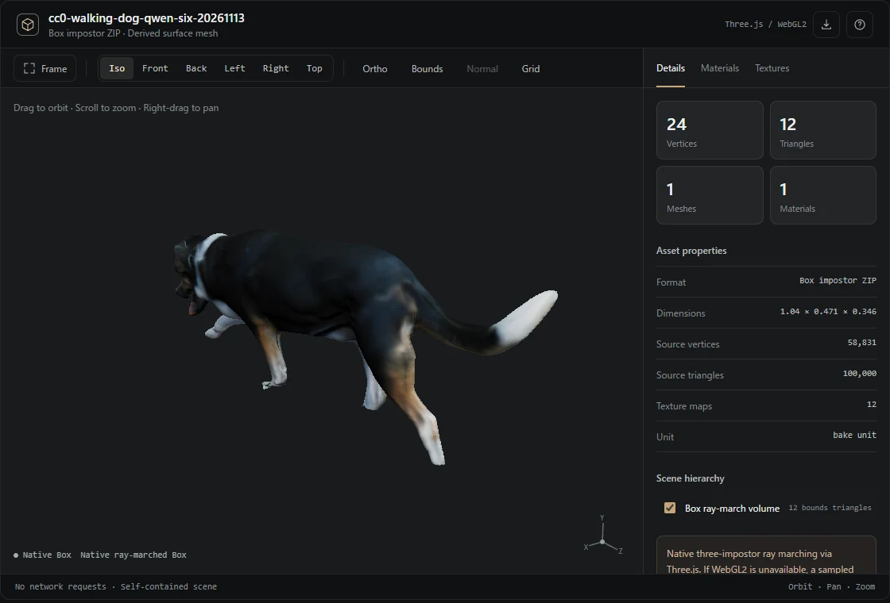

# Chat 3D Inspector Skill

Create **one self-contained HTML inspector** for polygon meshes and native Box Impostor assets. The output includes the model, textures and a pinned pre-bundled Three.js renderer. It needs **no network connection to display** and supports orbit, pan, zoom, screenshot, hierarchy/visibility, camera presets, material isolation and PBR texture inspection.



## Install

Install the [released Skill ZIP](../../chat-3d-viewer-skill.zip) in a supported agent workspace, or copy this `chat-3d-viewer` folder into a coding agent's Skills directory. Installation and direct interactive HTML embedding depend on the ChatGPT account and environment; publishing a Skill does not install it automatically.

The builder runs in Python with `numpy`, `Pillow` and `trimesh`:

```sh
pip install -r requirements.txt
python scripts/build_viewer.py /path/to/scene.glb --output /mnt/data/scene.inspector.html
python scripts/build_viewer.py /path/to/final.box.zip --output /mnt/data/box.inspector.html
```

The `native` renderer is the default. Use `--renderer legacy` for a compatibility-only Canvas2D preview. `--grid 96` changes only the sampled Box **fallback** resolution, never native raymarch quality. Source geometry is never changed.

## Native Box vs fallback

For a Box `.box.zip`, the HTML contains the lossless original RGBA16F color/normal/interval/range/material atlases plus a Three.js 0.186.0 + three-impostor 0.4.1 bundle. The renderer uses the official `ImpostorNodeMaterial`, not a reimplementation of its shader. The **native Box has 24 bounding vertices / 12 boundary triangles**, not thousands of reconstructed surface triangles. The sampled surface is retained strictly for browsers without WebGL2.

GLB, glTF, OBJ, STL, PLY and 3MF are imported by trimesh. Native viewing uses Three.js `MeshStandardMaterial` for available base color, normal, metallic/roughness, emissive and AO resources. Some glTF extension semantics, animation/rigging and Gaussian splatting are not supported.

In the right inspector, Details distinguishes source/proxy counts from rendered counts; Materials shows available PBR inputs and lets you isolate a material; Textures lists PNG visualizations with R/G/B/A channel and UV views. The original Box atlas bytes remain intact for native display; the texture-view thumbnails are 8-bit PNG previews.

## CDN findings

The pinned runtime is bundled into `assets/native-runtime.bundle.js` and copied into generated HTML at build time. No CDN or localhost server is required to open the HTML. In November 2026 testing with Edge, direct jsDelivr/unpkg/esm.sh fetches returned 200 and actual `import('three-impostor')` with an import map also succeeded in a sandboxed iframe. This does **not** prove that every ChatGPT client permits CDN requests; app-specific content security policy and network permissions vary.

## Build and verify

The pinned NPM dependencies and developer commands live in the repository root:

```sh
npm ci
npm run bundle
npm run test:browser
npm run probe:cdn
python -m unittest discover -s tests -p 'test_*.py'
python ../../tools/package_skill.py
```

Use a browser smoke test to verify normal rendering, camera controls, Textures and fallback. For unauthenticated, untrusted assets, audit archives for path traversal and oversized members first. Source files remain unmodified.

Bundled Three.js and three-impostor carry MIT notices under `assets/THIRD_PARTY_LICENSES.txt`. The UI direction borrows design principles from [unslop](https://github.com/heydamir/unslop), Damir Sokolovsky (CC BY 4.0); the viewer code is original.
